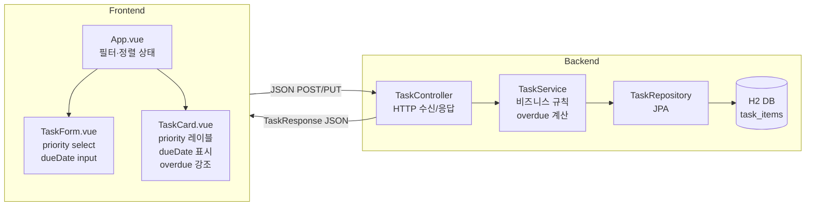

# Design Document

## Overview

이 문서는 기존 Vue 3 + Spring Boot MVC 작업 보드에 **우선순위(Priority)** 와 **마감일(Due Date)** 관리 기능을 추가하기 위한 설계를 기술한다. 백엔드에는 `TaskItem` 엔티티와 관련 DTO, 서비스 레이어에 신규 필드를 추가하고, 프런트엔드에는 필터·정렬 UI와 입력 컴포넌트를 확장한다. 기존 API 클라이언트와의 하위 호환성을 유지하며 점진적 배포를 지원한다.

---

## Architecture

기존 MVC 레이어 구조를 그대로 유지하면서 신규 필드를 각 레이어에 수직으로 추가한다.



**핵심 설계 원칙:**

- `overdue`는 DB에 저장하지 않고 `TaskResponse.from()` 호출 시점에 서버 시스템 시간대 기준으로 계산한다.
- `priority` 기본값 처리와 수정 시 기존 값 유지 로직은 `TaskService`에 집중한다.
- 잘못된 열거형·날짜 형식의 역직렬화 실패는 `ApiExceptionHandler`에서 일관되게 400으로 처리한다.
- 프런트엔드 필터·정렬은 서버 재요청 없이 클라이언트 측 `computed` 파이프라인으로 처리한다.

---

## Components and Interfaces

### 백엔드

#### Priority.java (신규)

`com.example.kiromvc.task` 패키지에 새 열거형 파일을 생성한다.

```java
package com.example.kiromvc.task;

public enum Priority {
    LOW, MEDIUM, HIGH
}
```

Jackson은 열거형 역직렬화 시 매핑되지 않는 문자열에 대해 `HttpMessageNotReadableException`을 발생시키며, 이를 `ApiExceptionHandler`에서 잡아 400으로 반환한다.

---

#### TaskItem.java 변경

`priority`와 `dueDate` 필드를 추가하고 `update()` 메서드 시그니처를 변경한다.

```java
// 신규 필드
@Enumerated(EnumType.STRING)
@Column(nullable = false, length = 10)
private Priority priority;

@Column
private java.time.LocalDate dueDate;
```

변경된 `update()` 시그니처:

```java
public void update(String title, String description, boolean completed,
                   Priority priority, java.time.LocalDate dueDate) {
    this.title = title;
    this.description = description;
    this.completed = completed;
    this.priority = priority;
    this.dueDate = dueDate;
}
```

생성자도 priority와 dueDate를 받도록 확장한다:

```java
public TaskItem(String title, String description, boolean completed,
                Priority priority, java.time.LocalDate dueDate) {
    this.title = title;
    this.description = description;
    this.completed = completed;
    this.priority = priority;
    this.dueDate = dueDate;
}
```

---

#### TaskRequest.java 변경

`priority`와 `dueDate`를 선택 입력(nullable)으로 추가한다.

```java
public record TaskRequest(
        @NotBlank(message = "제목은 필수입니다.")
        @Size(max = 120, message = "제목은 120자 이하여야 합니다.")
        String title,

        @Size(max = 500, message = "설명은 500자 이하여야 합니다.")
        String description,

        boolean completed,

        Priority priority,           // nullable — null이면 서비스 레이어에서 기본값 처리

        @JsonFormat(pattern = "yyyy-MM-dd")
        java.time.LocalDate dueDate  // nullable — 선택 입력
) {}
```

**잘못된 형식 처리 메커니즘:**

- `priority`에 `LOW|MEDIUM|HIGH` 이외 문자열 → Jackson이 `InvalidFormatException`(→ `HttpMessageNotReadableException`) 발생
- `dueDate`에 `YYYY-MM-DD` 이외 형식 → `@JsonFormat` 파싱 실패로 동일하게 `HttpMessageNotReadableException` 발생
- `ApiExceptionHandler`가 이를 잡아 HTTP 400 + RFC 9457 ProblemDetail 반환

---

#### TaskResponse.java 변경

신규 필드를 추가하고 `from()` 팩터리에 `overdue` 계산 로직을 포함한다.

```java
public record TaskResponse(
        Long id,
        String title,
        String description,
        boolean completed,
        Priority priority,
        java.time.LocalDate dueDate,
        boolean overdue,
        Instant createdAt,
        Instant updatedAt
) {
    static TaskResponse from(TaskItem task) {
        boolean overdue = !task.isCompleted()
                && task.getDueDate() != null
                && task.getDueDate().isBefore(java.time.LocalDate.now());

        return new TaskResponse(
                task.getId(),
                task.getTitle(),
                task.getDescription(),
                task.isCompleted(),
                task.getPriority(),
                task.getDueDate(),
                overdue,
                task.getCreatedAt(),
                task.getUpdatedAt()
        );
    }
}
```

기존 필드(`id`, `title`, `description`, `completed`, `createdAt`, `updatedAt`)는 순서와 타입을 유지하여 기존 클라이언트 하위 호환성을 보장한다.

---

#### TaskService.java 변경

**`create()` 메서드 — priority 기본값 처리:**

```java
@Transactional
public TaskResponse create(TaskRequest request) {
    Priority priority = Optional.ofNullable(request.priority())
            .orElse(Priority.MEDIUM);
    TaskItem task = new TaskItem(
            request.title().trim(),
            normalizeDescription(request.description()),
            request.completed(),
            priority,
            request.dueDate()
    );
    return TaskResponse.from(taskRepository.save(task));
}
```

**`update()` 메서드 — priority 기존 값 유지:**

```java
@Transactional
public TaskResponse update(Long id, TaskRequest request) {
    TaskItem task = getTask(id);
    Priority priority = Optional.ofNullable(request.priority())
            .orElse(task.getPriority()); // null이면 기존 값 유지
    task.update(
            request.title().trim(),
            normalizeDescription(request.description()),
            request.completed(),
            priority,
            request.dueDate()
    );
    return TaskResponse.from(task);
}
```

---

#### ApiExceptionHandler.java 변경

`HttpMessageNotReadableException` 핸들러를 추가한다.

```java
@ExceptionHandler(org.springframework.http.converter.HttpMessageNotReadableException.class)
ProblemDetail handleMessageNotReadable(
        org.springframework.http.converter.HttpMessageNotReadableException exception) {
    ProblemDetail problem = ProblemDetail.forStatusAndDetail(
            HttpStatus.BAD_REQUEST,
            "요청 본문을 파싱할 수 없습니다. 날짜 형식(YYYY-MM-DD) 또는 우선순위 값(LOW, MEDIUM, HIGH)을 확인해 주세요."
    );
    problem.setTitle("잘못된 요청 형식");
    return problem;
}
```

---

### 프런트엔드

#### App.vue 변경

`priorityFilter`와 `sortBy` 상태를 추가하고, 필터·정렬 파이프라인을 `sortedAndFilteredTasks` computed로 통합한다.

```javascript
const priorityFilter = ref('all')   // 'all' | 'LOW' | 'MEDIUM' | 'HIGH'
const sortBy = ref('createdAt')     // 'createdAt' | 'dueDate'

const sortedAndFilteredTasks = computed(() => {
  // 1단계: 완료 상태 필터
  let result = tasks.value
  if (filter.value === 'active') result = result.filter(t => !t.completed)
  else if (filter.value === 'done') result = result.filter(t => t.completed)

  // 2단계: 우선순위 필터
  if (priorityFilter.value !== 'all') {
    result = result.filter(t => t.priority === priorityFilter.value)
  }

  // 3단계: 정렬
  if (sortBy.value === 'dueDate') {
    result = [...result].sort((a, b) => {
      if (a.dueDate === null && b.dueDate === null)
        return new Date(b.createdAt) - new Date(a.createdAt)
      if (a.dueDate === null) return 1   // null은 항상 뒤
      if (b.dueDate === null) return -1
      if (a.dueDate !== b.dueDate)
        return a.dueDate.localeCompare(b.dueDate)  // YYYY-MM-DD 사전 순 = 날짜 오름차순
      return new Date(b.createdAt) - new Date(a.createdAt) // tie-break
    })
  } else {
    // 기본: createdAt 내림차순
    result = [...result].sort((a, b) => new Date(b.createdAt) - new Date(a.createdAt))
  }

  return result
})
```

**UI 추가:**
- 우선순위 필터 버튼 그룹: `전체 / LOW / MEDIUM / HIGH`
- 정렬 셀렉트: `기본(등록 순) / 마감 임박 순`
- 빈 결과 메시지는 기존 empty-state 그대로 재사용

---

#### TaskForm.vue 변경

`form` reactive 객체에 `priority`와 `dueDate`를 추가하고 해당 입력 요소를 추가한다.

```javascript
const form = reactive({
  title: '',
  description: '',
  priority: 'MEDIUM',
  dueDate: '',
})

function submit() {
  if (!form.title.trim()) return
  emit('submit', {
    title: form.title.trim(),
    description: form.description.trim(),
    completed: false,
    priority: form.priority,
    dueDate: form.dueDate || null,
  })
  form.title = ''
  form.description = ''
  form.priority = 'MEDIUM'
  form.dueDate = ''
}
```

초기값 수신을 위한 `initialTask` prop을 선택적으로 지원하며, 전달된 경우 `onMounted`에서 form을 채운다.

**추가 템플릿 요소:**

```html
<!-- 우선순위 선택 -->
<label>
  <span>우선순위</span>
  <select v-model="form.priority">
    <option value="LOW">LOW</option>
    <option value="MEDIUM">MEDIUM</option>
    <option value="HIGH">HIGH</option>
  </select>
</label>

<!-- 마감일 입력 -->
<label>
  <span>마감일</span>
  <input type="date" v-model="form.dueDate" />
</label>
```

---

#### TaskCard.vue 변경

`draft`에 `priority`와 `dueDate`를 추가하고, `watch`에서 동기화하며, 보기/편집 모드 템플릿을 확장한다.

```javascript
const draft = reactive({ title: '', description: '', priority: 'MEDIUM', dueDate: '' })

watch(
  () => props.task,
  (task) => {
    draft.title = task.title
    draft.description = task.description || ''
    draft.priority = task.priority || 'MEDIUM'
    draft.dueDate = task.dueDate || ''
  },
  { immediate: true },
)

const dueDateFormatted = computed(() => {
  if (!props.task.dueDate) return null
  const [y, m, d] = props.task.dueDate.split('-')
  return `${y}년 ${m}월 ${d}일`
})

function toggleCompleted() {
  emit('update', props.task.id, {
    title: props.task.title,
    description: props.task.description || '',
    completed: !props.task.completed,
    priority: props.task.priority,
    dueDate: props.task.dueDate || null,
  })
}

function save() {
  if (!draft.title.trim()) return
  emit('update', props.task.id, {
    title: draft.title.trim(),
    description: draft.description.trim(),
    completed: props.task.completed,
    priority: draft.priority,
    dueDate: draft.dueDate || null,
  })
  editing.value = false
}
```

**보기 모드 추가 템플릿:**

```html
<article class="task-card" :class="{ completed: task.completed, overdue: task.overdue }">
  <!-- 기존 task-meta -->
  <span class="priority-label" :class="task.priority.toLowerCase()">{{ task.priority }}</span>
  <span v-if="dueDateFormatted" class="due-date">{{ dueDateFormatted }}</span>
  <span v-if="task.overdue" class="overdue-label">기한 초과</span>
</article>
```

**편집 모드 추가 템플릿:**

```html
<select v-model="draft.priority">
  <option value="LOW">LOW</option>
  <option value="MEDIUM">MEDIUM</option>
  <option value="HIGH">HIGH</option>
</select>
<input type="date" v-model="draft.dueDate" />
```

---

#### taskApi.js

변경 불필요. 이미 task 객체를 JSON 직렬화하여 전송하므로 `priority`와 `dueDate` 필드가 자동으로 포함된다.

---

## Data Models

### TaskItem 엔티티 (변경 후)

| 필드 | 타입 | 제약 | 변경 여부 |
|------|------|------|-----------|
| `id` | `Long` | PK, AUTO | 기존 |
| `title` | `String` | max 120, not null | 기존 |
| `description` | `String` | max 500, nullable | 기존 |
| `completed` | `boolean` | not null | 기존 |
| `createdAt` | `Instant` | not null, immutable | 기존 |
| `updatedAt` | `Instant` | not null | 기존 |
| `priority` | `Priority` | ENUM STRING, not null | **신규** |
| `dueDate` | `LocalDate` | nullable | **신규** |

### Priority 열거형

| 값 | 의미 |
|----|------|
| `LOW` | 낮은 우선순위 |
| `MEDIUM` | 보통 우선순위 (기본값) |
| `HIGH` | 높은 우선순위 |

### TaskRequest DTO (변경 후)

| 필드 | 타입 | 필수 여부 | 비고 |
|------|------|-----------|------|
| `title` | `String` | 필수 | max 120, not blank |
| `description` | `String` | 선택 | max 500 |
| `completed` | `boolean` | 필수 | |
| `priority` | `Priority` | 선택 | null 시 create: MEDIUM, update: 기존 값 유지 |
| `dueDate` | `LocalDate` | 선택 | YYYY-MM-DD 형식, null 허용 |

### TaskResponse DTO (변경 후)

| 필드 | 타입 | 비고 |
|------|------|------|
| `id` | `Long` | 기존 |
| `title` | `String` | 기존 |
| `description` | `String` | 기존 |
| `completed` | `boolean` | 기존 |
| `createdAt` | `Instant` | 기존 |
| `updatedAt` | `Instant` | 기존 |
| `priority` | `Priority` | 신규 |
| `dueDate` | `LocalDate` | 신규, nullable |
| `overdue` | `boolean` | 신규, DB 미저장 — 서비스 레이어 계산 |

### overdue 계산 규칙 (진리표)

| completed | dueDate | 조건 | overdue |
|-----------|---------|------|---------|
| `true` | 임의 | — | `false` |
| `false` | `null` | — | `false` |
| `false` | 오늘 이전 | `dueDate < LocalDate.now()` | `true` |
| `false` | 오늘 | `dueDate == LocalDate.now()` | `false` |
| `false` | 미래 | `dueDate > LocalDate.now()` | `false` |

---

## Correctness Properties

*속성(Property)이란 시스템의 모든 유효한 실행에서 성립해야 하는 특성이나 동작을 말한다 — 즉, 시스템이 해야 하는 것에 대한 형식적 진술이다. 속성은 사람이 읽을 수 있는 명세와 기계가 검증할 수 있는 정확성 보증을 연결하는 다리 역할을 한다.*

백엔드는 **jqwik**(Java PBT 라이브러리)을, 프런트엔드는 **fast-check**(JavaScript PBT 라이브러리)를 사용하여 각 속성을 검증한다. 각 속성 테스트는 최소 100회 반복 실행한다.

### Property 1: priority null → MEDIUM 기본값

*임의의* 유효한 `title`과 `description`을 가진 `TaskRequest`에서 `priority`가 `null`인 경우, `TaskService.create()`가 반환하는 `TaskResponse`의 `priority`는 항상 `MEDIUM`이다.

**Validates: Requirements 1.2, 8.1**

---

### Property 2: priority 라운드트립 보존

*임의의* `Priority` 열거형 값(`LOW`, `MEDIUM`, `HIGH`)과 유효한 `title`로 생성된 작업에서, `TaskService.create()`가 반환하는 `TaskResponse.priority`는 요청에서 전달한 `priority` 값과 동일하다.

**Validates: Requirements 1.5**

---

### Property 3: update 시 priority null → 기존 값 유지

*임의의* `Priority` 값을 가진 작업을 생성한 후, `priority=null`인 `TaskRequest`로 `TaskService.update()`를 호출하면 반환되는 `TaskResponse.priority`는 생성 시 사용된 원래 `priority` 값과 동일하다.

**Validates: Requirements 1.6, 8.2**

---

### Property 4: overdue — 과거 날짜 + 미완료

*임의의* 오늘(`LocalDate.now()`)보다 이전인 `dueDate`와 `completed=false`를 가진 `TaskItem`에 대해 `TaskResponse.from()`이 계산하는 `overdue`는 항상 `true`이다.

**Validates: Requirements 3.2**

---

### Property 5: overdue — completed=true이면 항상 false

*임의의* `dueDate`(과거, 오늘, 미래, null 포함) 값을 가진 `TaskItem`에서 `completed=true`이면, `TaskResponse.from()`이 계산하는 `overdue`는 항상 `false`이다.

**Validates: Requirements 3.3**

---

### Property 6: overdue — 오늘 날짜는 false

*임의의* `completed=false`인 `TaskItem`에서 `dueDate`가 `LocalDate.now()`와 동일하면, `TaskResponse.from()`이 계산하는 `overdue`는 `false`이다.

**Validates: Requirements 3.5**

---

### Property 7: 우선순위 필터 — 렌더링된 모든 항목이 조건 충족

*임의의* 작업 배열과 `LOW | MEDIUM | HIGH` 중 하나의 `priorityFilter` 값에 대해 `sortedAndFilteredTasks` computed가 반환하는 모든 작업의 `priority`는 해당 `priorityFilter` 값과 동일하다.

**Validates: Requirements 4.2**

---

### Property 8: 완료 상태 + 우선순위 AND 필터

*임의의* 작업 배열, 완료 상태 필터(`active` | `done`), 우선순위 필터(`LOW` | `MEDIUM` | `HIGH`)의 조합에서 `sortedAndFilteredTasks` computed가 반환하는 모든 작업은 두 필터 조건을 동시에 만족한다.

**Validates: Requirements 4.4**

---

### Property 9: 마감 임박 순 정렬 — 인접 쌍 순서 불변

*임의의* 작업 배열에서 `sortBy='dueDate'`를 적용했을 때, `sortedAndFilteredTasks` 결과의 인접한 두 작업 `a`(앞)와 `b`(뒤)에 대해 다음이 성립한다:

- `a.dueDate !== null && b.dueDate !== null` → `a.dueDate ≤ b.dueDate`
- `a.dueDate !== null && b.dueDate === null` → 항상 성립 (null은 뒤)
- `a.dueDate === null && b.dueDate !== null` → 불가능 (null은 항상 뒤)
- `a.dueDate === b.dueDate` → `a.createdAt ≥ b.createdAt` (tie-break: createdAt desc)

**Validates: Requirements 5.2, 5.3, 5.4**

---

## Error Handling

### 백엔드 오류 처리 전략

| 상황 | 발생 예외 | HTTP 응답 | 처리 위치 |
|------|-----------|-----------|-----------|
| 존재하지 않는 task ID | `TaskNotFoundException` | 404 ProblemDetail | `ApiExceptionHandler` |
| `@NotBlank`, `@Size` 위반 | `MethodArgumentNotValidException` | 400 ProblemDetail + `errors` 맵 | `ApiExceptionHandler` |
| 잘못된 priority 문자열 또는 dueDate 형식 | `HttpMessageNotReadableException` | 400 ProblemDetail | `ApiExceptionHandler` (신규 핸들러) |

**RFC 9457 ProblemDetail 응답 형식 예시 (잘못된 형식):**

```json
{
  "type": "about:blank",
  "title": "잘못된 요청 형식",
  "status": 400,
  "detail": "요청 본문을 파싱할 수 없습니다. 날짜 형식(YYYY-MM-DD) 또는 우선순위 값(LOW, MEDIUM, HIGH)을 확인해 주세요."
}
```

### 프런트엔드 오류 처리 전략

- API 오류 시 `error` ref에 메시지를 저장하고 화면에 표시하는 기존 패턴을 유지한다.
- 날짜 입력(`<input type="date">`)은 브라우저 기본 UI를 통해 형식이 보장되므로 클라이언트 측 추가 검증은 불필요하다.

---

## Testing Strategy

### 백엔드 단위 테스트 (`TaskServiceTest` 추가 케이스)

- `priority=null`로 생성 시 `MEDIUM` 기본값 설정 확인 (Property 1 예시 케이스)
- `priority=LOW`로 생성 후 `priority=null`로 업데이트 시 `LOW` 유지 확인 (Property 3 예시 케이스)
- `overdue` 계산 5가지 케이스: 과거+미완료(true), 완료+과거(false), null dueDate(false), 오늘(false), 미래(false) (Properties 4–6 예시 케이스)

### 백엔드 속성 기반 테스트 (jqwik)

각 속성을 jqwik `@Property` 테스트로 구현한다. 태그 형식: `// Feature: task-priority-due-date, Property N: <속성 제목>`

- `@Property` 최소 100회(`tries = 100`) 반복
- `@ForAll` 어노테이션으로 `Priority`, `LocalDate`, `String` 임의 값 생성
- `overdue` 계산은 순수 로직이므로 repository mock 없이 테스트 가능

### 프런트엔드 단위/속성 테스트 (Vitest + fast-check)

- `sortedAndFilteredTasks` computed 로직을 순수 함수로 추출하여 fast-check로 속성 테스트
- Property 7, 8, 9를 `fc.assert(fc.property(...))` 형태로 구현
- `TaskCard.vue`, `TaskForm.vue`의 priority/dueDate 렌더링은 Vitest + Vue Test Utils 스냅샷 테스트
- 태그 형식: `// Feature: task-priority-due-date, Property N: <속성 제목>`
